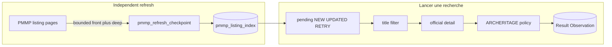

# Final incremental Radar 1 PMMP workflow

## Locked decisions
- Business button stays process-only (`indexed_title_batch`, `pmmp_sync_mode=not_requested`).
- Refresh is separate: CLI + authenticated API; status shown on Radar 1.
- Render Free: no in-process scheduler. Doc will prescribe external cron calling `POST /api/radars/1/pmmp-refresh` or `flask radar1-pmmp-refresh`. Durable cursor + lease survive spin-down/restart.
- No production crawl or candidate consumption in this work; fixtures + isolated SQLite only.
- Do not claim live success until a later real refresh proves new listings enter Neon.
- Preserve all existing business processing logic, review decisions, and indexed data (no bulk reset/reclassify).

## Success semantics (explicit)
- A bounded refresh finishing with `status=idle` and a success stop means **this pass’s page/time budget completed** (or a recoverable stop was recorded).
- It does **not** mean the entire PMMP catalogue was reconciled.
- Catalogue reconciliation is complete only when a deep cycle wraps (`cursor` reaches/passes `declared_pages` / final page) and that wrap is recorded separately as `cycle_complete` / `last_cycle_completed_at`.
- UI and docs must distinguish: last-pass budget success vs last full-cycle completion vs historical index size.

## Current gaps
- [`sync_listings`](backend/app/modules/radar1_markets/pmmp_listing_index.py) forces `collect(mode='full')`, ignoring incremental/overlap.
- No durable page cursor with safe recovery when PMMP session tokens expire.
- No cross-process refresh lease; age-only reclaim would be unsafe.
- UPDATED classify today clears processing ownership without CAS against an active business claim.
- No independent refresh status; UI only shows per-run `radar1_progress`.
- Preserve ~560 pending title-pass rows; skip completed REJECTED/PROCESSED with matching fingerprint + `archeritage-r11`.

## Safety requirements (must ship)

### S1. Refresh worker reliability (no concurrent / stuck duplicates)
- Single-flight across processes/deployments via DB lease on the singleton checkpoint row:
  - `lease_owner` (opaque UUID/token generated by the worker)
  - `lease_until` (absolute expiry)
  - `heartbeat_at` updated after each committed page
- Acquire with conditional UPDATE: only if `status` in (`idle`,`failed`) **or** (`running` and lease expired **and** heartbeat stale under the same lease predicate). Never acquire by wall-clock age of `last_started_at` alone.
- On acquire: set `status=running`, new `lease_owner`, `lease_until`, `heartbeat_at`, `last_started_at`.
- Each page commit renews `heartbeat_at` and extends `lease_until` (short TTL, e.g. 2–3 minutes).
- On clean finish: clear `lease_owner`, set `status=idle`, `last_finished_at`, record pass metrics.
- On crash/restart: another worker may take over **only** after lease+heartbeat prove the prior owner is dead; work resumes from durable `cursor_page` (not from scratch unless recovery requires re-navigation).
- Passes remain hard-bounded by front/deep page caps and max seconds so a live owner cannot run forever.
- API/CLI must refuse a second start while a valid lease is held (409 / clear error).

### S2. PRADO PAGESTATE is soft state only
- Persisted `page_state` is a **hint**, never assumed valid across HTTP sessions or deployments.
- Resume algorithm:
  1. Try next-page POST with saved PAGESTATE.
  2. If invalid/expired/unexpected HTML/signature mismatch: **discard token**, start a fresh search session from page 1, then **re-navigate forward** by walking pages until `cursor_page` (already durably completed pages), without re-applying classify side effects for pages below the cursor when observations are duplicates/unchanged — goal is to reach the next unprocessed page without skipping deeper pages.
  3. Never jump ahead of `cursor_page` after a failed token.
  4. After successful page N classify+commit, store new PAGESTATE + signature + `cursor_page=N`.
- Front pass always uses a fresh session from page 1 (does not depend on deep PAGESTATE).

### S3. Concurrent UPDATED vs business processing
- Never blindly clear `processing_run_id` / force `PENDING_PROCESSING` on UPDATED.
- Atomic classify for known rows:
  - UNCHANGED: only `last_seen_at` (and flush); leave processing fields untouched.
  - UPDATED when `processing_state == PROCESSING` and claim still owned by an **active** SearchRun: update listing content/fingerprint/`last_changed_at` **without** stealing the owner; leave state `PROCESSING` so the in-flight worker finishes or releases; after release, existing `pending_rows()` fingerprint mismatch / retry paths pick up re-eval. Optionally set a non-destructive reason note that does not clear the lease.
  - UPDATED when not actively owned: CAS update to `PENDING_PROCESSING`, clear owner/started_at only in that same conditional UPDATE (identity + previous fingerprint/version match).
- Refresh must not invalidate Result/review rows; business persistence/`acknowledge_candidate` remain the only path that terminalizes accepted work.

### S4. Stale refresh recovery without age-only reclaim
- Recovery condition is **lease ownership evidence**, not “started > 15 minutes ago”.
- Reclaim allowed only when: `lease_until < now` **and** `heartbeat_at` is older than the lease TTL (or null after a crashed acquire), via the same CAS acquire.
- If status is `running` but lease still valid: leave alone; surface `owner`/`heartbeat_at` in status for operators.
- Explicit operator recovery path (CLI flag or documented SQL is **not** preferred): CLI `--force-release-expired-lease` only performs the same CAS predicate (expired lease), never force-kills a live lease. Uncertain ownership stays blocked until lease expiry.
- No automatic reclaim based solely on elapsed time since start.

## 1. Checkpoint model + migration
Singleton table `pmmp_refresh_checkpoint` (Alembic after `e7c91b2486af`):
- status: idle | running | failed
- lease_owner, lease_until, heartbeat_at
- cursor_page, page_state (soft), page_signature
- declared_pages / declared_results
- cycle_complete, last_cycle_completed_at
- last_success_at (= last **pass** budget success), last_started_at, last_finished_at
- last-pass and cycle counters (new/updated/unchanged/pages/stop_reason)
- last_error

No bulk reset of `pmmp_listing_index` rows.

## 2. Collector + classify
[`pmmp_listing_collector.py`](backend/app/modules/radar1_markets/pmmp_listing_collector.py):
- Honor mode (incremental / full / reconciliation).
- Soft PAGESTATE resume + re-navigation helper when token fails; per-page callback with page_state/signature/rows.
- Keep delay/retries; no paid search/AI/browser.

[`DurableListingIndex`](backend/app/modules/radar1_markets/pmmp_listing_index.py):
- Identity via consultation_id / identity_key; compare fingerprint.
- NEW -> PENDING_PROCESSING.
- UNCHANGED -> last_seen_at only.
- UPDATED -> concurrent-safe path per S3 (no blind owner clear).
- Fix `sync_listings` to pass requested mode (stop forcing full).

## 3. Refresh orchestrator
New [`pmmp_refresh.py`](backend/app/modules/radar1_markets/pmmp_refresh.py):
- `refresh_status()` and leased `run_refresh(...)`.
- **Front pass** from page 1 (default 5 pages); **deep segment** toward next pages (default 15) under shared max seconds (default 90).
- Commit each page (index + checkpoint heartbeat/lease renewal) before next HTTP.
- Mark **cycle complete** only on final_page / cursor >= declared_pages — never from three unchanged pages alone.
- Mark **pass success** when the bounded budget finishes cleanly (even if cycle incomplete).
- Config: `RADAR1_PMMP_REFRESH_FRONT_PAGES`, `RADAR1_PMMP_REFRESH_DEEP_PAGES`, `RADAR1_PMMP_REFRESH_MAX_SECONDS`, `RADAR1_PMMP_REFRESH_LEASE_SECONDS`.

## 4. Triggers
- CLI `flask radar1-pmmp-refresh` in [`cli.py`](backend/app/cli.py) (sync JSON report; optional expired-lease force matching S4). Keep baseline CLI for rare full imports.
- Auth API: `POST /radars/1/pmmp-refresh` submits on `radar_job_runner`, returns 202 (409 if valid lease held); embed `pmmp_refresh` in Radar 1 `_radar()` payload including lease/heartbeat and pass-vs-cycle fields.
- Must not create/block SearchRun.

## 5. Business path
Keep [`pmmp_index_discovery`](backend/app/modules/radar1_markets/collector.py) without sync.
- Keep `pending_rows()` lazy policy-version recert (no automatic full reset).
- Snapshot refresh status into `collector_metrics.pmmp_refresh_snapshot` at run start.

## 6. UI observability
Update [`frontend/app/radars/[radarId]/page.tsx`](frontend/app/radars/[radarId]/page.tsx) + types: separate strip for latest **pass** success time, whether last **cycle** completed, last-pass NEW/UPDATED/UNCHANGED, pending business, vs current-run processed/relevant. Label clearly that a green pass != full catalogue sync.

## 7. Tests
Fixture/ScriptedHttp tests proving:
- second acquire blocked while lease+heartbeat valid; reclaim only after lease expiry
- restart mid-pass resumes cursor without duplicate identities
- PAGESTATE invalidation triggers re-navigation to cursor without skipping deeper pages
- UPDATED during active PROCESSING does not steal owner; UPDATED when idle requeues via CAS
- no reprocess of completed unchanged; pending preserved; NEW reaches title filter
- business collect does not crawl; HTTP bounded by budgets
- pass success with incomplete cycle is reported distinctly from cycle_complete

## 8. Doc
[`backend/docs/RADAR1_INCREMENTAL_FINAL.md`](backend/docs/RADAR1_INCREMENTAL_FINAL.md): changes, triggers, budgets/checkpoint, lease/PAGESTATE/UPDATED safety, pass-vs-cycle success semantics, cost safeguards, migration, Render Free cron steps, first manual verification, explicit unproven-live note.

## Out of scope
Policy changes, Radars 2-5, deleting index/results, real crawl/deploy/live cron from this session.
